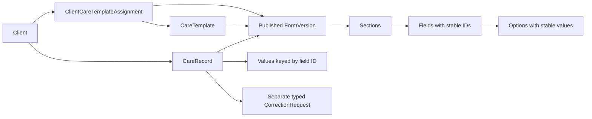

# Configurable form foundation — Phase 1C.2

This is a typed, development-only rendering model, not an Admin builder, clinical standard or production validation service. `src/modules/forms` contains the presentation-independent types/engine and source-derived controls. Care Plan owns assignments/record workflows under `src/modules/staff/care`; future Charting can reuse the form engine without depending on category names.

A template has a stable ID, name, description, care/chart kind and readonly published versions. Each version contains sections, each with its own fields. Sections and fields may declare visibility rules. An active client assignment identifies the permitted template and version for new records. History and draft reopening use the record's version, never the current version by default. The phase has no operation that edits published versions. Persistent version immutability and referential constraints await the backend.

## Controls and validation

| Type | Presentation and behaviour |
| --- | --- |
| `text` | Short text input |
| `textarea` | Long text with original spacing |
| `number` | Numeric input, finite values, optional min/max/step validation; zero is valid |
| `yesno` | Yes/No source-style radio buttons |
| `select` | Labelled native dropdown with configured options |
| `radio` | Configured source-style single-choice group |
| `multi` | Configured toggle buttons with pressed state, multiple values |
| `date` | Calendar date; invalid/overflow dates rejected |
| `time` | Local time in HH:mm, no implicit event date |
| `datetime` | Pacific/Auckland wall-time input, normalized to UTC ISO in saved mock values |
| `scale` | Source numeric choice scale, configured bounds/step |
| `photo`, `file`, `table` | Reserved discriminated variants, visibly unavailable; no picker, upload, editable table or pretend saved value |

Options have stable `value` and display `label` fields. Labels, help, placeholders, required state, bounds and default values belong to the configuration. Defaults apply once to new forms; opening a saved draft uses its saved values. Required fields use an asterisk and accessible required state, not colour alone. Single-choice controls use a labelled radiogroup with arrow/Home/End navigation and roving focus. Multiple-choice buttons expose pressed state. Errors are associated with their controls and announced through the shared FormField.

The generic renderer branches on field type, never on template/category name. Validation checks only visible supported fields, including required values, selected options, finite numbers/ranges, calendar dates/times and unambiguous NZ datetime values. It is basic data validation, not clinical advice or advanced clinical validation. Fictional numeric limits/scales are UI examples only. The observation/covered time, creation time and submission time remain separate record metadata. Submission requires an off-shift reason when the existing demo attendance state is absent or no longer eligible.

## Declarative conditions and hidden values

A rule contains `fieldId`, `op` (`equals`, `not_equals`, `includes`) and a scalar comparison value. No expressions, scripts or arbitrary JavaScript are accepted. A section rule gates all its fields; field rules can further restrict individual questions. Controllers must themselves exist, be visible and have a non-empty value. Cycles and missing controllers fail closed. For array answers, equality/includes use membership; not-equals negates membership. Section controllers should be located outside their own gated section.

Policy: **clear hidden answers immediately and exclude them again on save**. Changing a controller runs `sanitizeValues`; previously hidden answers do not reappear when the condition is enabled again. Unknown field IDs and unsupported attachment/table values are also excluded. Hidden required questions do not block submission. `normalizeFormValues` converts valid datetime answers to UTC ISO; the editor converts them back to NZ wall time. Missing/repeated DST times are rejected rather than silently shifted.

## Drafts, submission and corrections

The existing Staff snapshot/provider contains templates, assignments and records, alongside diary records and one shared correction array. There is no independent data store. Own incomplete drafts can be saved, resumed and edited. Client/template assignment, author and draft state are checked by pure mock adapter operations; submitted or corrected records cannot be edited through those operations. Draft creation timestamps and template versions are retained on submission. Submitted details are read-only and show session-only success feedback.

CorrectionRequest now optionally discriminates `recordType: diary | care`; missing values retain diary compatibility. Shared correction helpers prevent duplicate pending requests and retain reason, proposal, requester and timestamp. Diary and assessment workflows resolve their own scoped records before using those helpers. Assessment proposals may identify field labels/IDs and intended values in text, alongside the original structured answers. Requests never replace original values. There is no staff approve/reject operation or UI. Corrected status is supported in display/types, but no management approval or corrected-version generation is simulated.

## Extension limits

Future phases may add secure photo/file answers, repeatable editable tables and chart configuration using new discriminated field variants. The reserved controls presently state that they are unavailable; a required unsupported type blocks submission rather than claiming success. Admin schema authoring/validation, published-version management, clinical review, database constraints, concurrency, durable audit, authenticated permissions and private attachments remain unimplemented. All demo changes reset on reload/remount. Only fictional records may be used.
