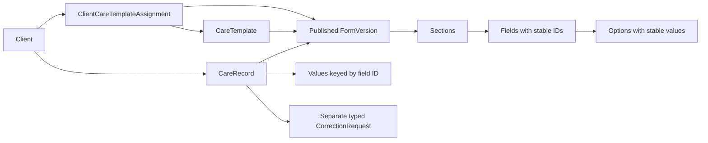

# Configurable form foundation — Phase 1C.3

This is a typed, development-only rendering model, not an Admin builder, clinical standard or production validation service. `src/modules/forms` contains the presentation-independent types/engine and source-derived controls. Care Plan owns assignments/record workflows under `src/modules/staff/care`; Charting reuses the form engine without depending on category names.



A template has a stable ID, name, description, care/chart kind and readonly published versions. Each version contains sections, each with its own fields. Sections and fields may declare visibility rules. An active client assignment identifies the permitted template and version for new records. History and draft reopening use the record's version, never the current version by default. The phase has no operation that edits published versions. Persistent version immutability and referential constraints await the backend.

## Controls and validation

| Type | Presentation and behaviour |
| --- | --- |
| `text` | Short text input |
| `textarea` | Long text with original spacing |
| `number` | Numeric input, finite values, optional min/max/step validation; zero is valid |
| `yesno` | Yes/No source-style radio buttons |
| `select` | Labelled native dropdown with configured options |
| `radio` | Configured source-style single-choice group |
| `multi` | Configured toggle buttons with pressed state, multiple values |
| `date` | Calendar date; invalid/overflow dates rejected |
| `time` | Local time in HH:mm, no implicit event date |
| `datetime` | Pacific/Auckland wall-time input, normalized to UTC ISO in saved mock values |
| `scale` | Source numeric choice scale, configured bounds/step |
| `photo`, `file`, `table` | Reserved discriminated variants, visibly unavailable; no picker, upload, editable table or pretend saved value |

Options have stable `value` and display `label` fields. Labels, help, placeholders, required state, bounds and default values belong to the configuration. Defaults apply once to new forms; opening a saved draft uses its saved values. Required fields use an asterisk and accessible required state, not colour alone. Single-choice controls use a labelled radiogroup with arrow/Home/End navigation and roving focus. Multiple-choice buttons expose pressed state. Errors are associated with their controls and announced through the shared FormField.

The generic renderer branches on field type, never on template/category name. Validation checks only visible supported fields, including required values, selected options, finite numbers/ranges, calendar dates/times and unambiguous NZ datetime values. It is basic data validation, not clinical advice or advanced clinical validation. Fictional numeric limits/scales are UI examples only. The observation/covered time, creation time and submission time remain separate record metadata. Submission requires an off-shift reason when the existing demo attendance state is absent or no longer eligible.

## Declarative conditions and hidden values

A rule contains `fieldId`, `op` (`equals`, `not_equals`, `includes`) and a scalar comparison value. No expressions, scripts or arbitrary JavaScript are accepted. A section rule gates all its fields; field rules can further restrict individual questions. Controllers must themselves exist, be visible and have a non-empty value. Cycles and missing controllers fail closed. For array answers, equality/includes use membership; not-equals negates membership. Section controllers should be located outside their own gated section.

Policy: **clear hidden answers immediately and exclude them again on save**. Changing a controller runs `sanitizeValues`; previously hidden answers do not reappear when the condition is enabled again. Unknown field IDs and unsupported attachment/table values are also excluded. Hidden required questions do not block submission. `normalizeFormValues` converts valid datetime answers to UTC ISO; the editor converts them back to NZ wall time. Missing/repeated DST times are rejected rather than silently shifted.

## Drafts, submission and corrections

The existing Staff snapshot/provider contains templates, assignments and records, alongside diary records and one shared correction array. There is no independent data store. Own incomplete drafts can be saved, resumed and edited. Client/template assignment, author and draft state are checked by pure mock adapter operations; submitted or corrected records cannot be edited through those operations. Draft creation timestamps and template versions are retained on submission. Submitted details are read-only and show session-only success feedback.

CorrectionRequest now optionally discriminates `recordType: diary | care`; missing values retain diary compatibility. Shared correction helpers prevent duplicate pending requests and retain reason, proposal, requester and timestamp. Diary and assessment workflows resolve their own scoped records before using those helpers. Assessment proposals may identify field labels/IDs and intended values in text, alongside the original structured answers. Requests never replace original values. There is no staff approve/reject operation or UI. Corrected status is supported in display/types, but no management approval or corrected-version generation is simulated.

## Extension limits

Phase 1C.3 adds the repeating-table variant and chart presentation metadata described below. Future phases may add secure photo/file answers and more advanced chart configuration. The reserved controls presently state that they are unavailable; a required unsupported type blocks submission rather than claiming success. Admin schema authoring/validation, published-version management, clinical review, database constraints, concurrency, durable audit, authenticated permissions and private attachments remain unimplemented. All demo changes reset on reload/remount. Only fictional records may be used.

## Repeating editable tables (Phase 1C.3)

`FormFieldDefinition` adds `type: repeatingTable`. A table retains the common stable field ID, label, help, required state and optional visibility rule; its configuration adds readonly `columns`, optional `minRows`/`maxRows` and `allowAdd`. No universal row cap is imposed. The equipment fixture explicitly configures 1–6 rows. A column has a stable ID, label, help, required state and a discriminated input kind. Supported cells: text, number (finite/min/max/step), calendar date, time, Yes/No, dropdown and radio. Photo/file column variants are reserved and visibly unavailable; required unsupported cells prevent submission. Nested tables and multi-choice cells are excluded. The older reserved `table` placeholder remains unavailable where no column definition was provided; it is not silently upgraded.

```ts
interface CareTableRow {
  id: string
  values: Record<string, string | number>
}
// FormValues[fieldId] = CareTableRow[]
```

Each table belongs to its field within a CareRecord. Row order is array order; row identity is a UUID for newly added rows or a stable fictional fixture ID. Removing a draft row filters by ID, never index. Surviving rows retain their IDs and answers. Focus goes to the new row's first control, the nearest surviving row on removal, or Add Row when empty. Add Row disables at the configured maximum and explains why. With `allowAdd: false`, additional rows are unavailable; existing configured/draft rows can still be edited/removed and submission must satisfy configured minima.

Table validation uses the same scalar field validation through synthetic sections. Errors are keyed by `fieldId.rowId.columnId` and identify visible row number and column label. Table-level errors identify minimum/maximum counts, malformed data and duplicate/empty row IDs. Required tables need at least one row; configured minima can require more. Blank optional tables are valid. Incomplete drafts can be saved without submission validation. Hidden tables are cleared/excluded like other hidden answers; unknown/unsupported cell keys are excluded. Normalisation copies rows/values and retains IDs/order without mutating the original.

The shared renderer branches on `repeatingTable`, not category name. Source `.cm-repeat`, `.cm-repeat-row` and `.cm-repeat-cell` classes present stacked mobile rows and desktop grids. Every input names its row and column and reuses the existing accessible field renderer/error associations. Submitted details use a separate semantic read-only table inside a labelled, keyboard-focusable scroll region. All column values remain accessible; no edit/add/remove controls appear there. Historical rendering resolves the record's original version and its field/column IDs, including an equipment v1 fixture with a renamed label and no maintenance column alongside assigned v2. Published versions have no update operation. Backend immutability and concurrency remain future work.

## Chart history and numeric visualisation

`CareTemplate.kind` keeps staff Care Plan and Charting separate while sharing templates, assignments, CareRecord values, author/version metadata and lifecycle operations. `history.columns` selects stable field IDs for the navigational history index. Repeating table values appear as row-count summaries there; complete rows open in details. History indexes are derived record projections, not editable table values. Cell formatting resolves each record's original field definition, avoiding current-version option reinterpretation.

`history.chart` declares a numeric `fieldId` and `unit`. The source CSS bar display uses only actual finite numeric values in submitted/corrected records with a numeric field in the corresponding original version. Drafts, missing values and nonnumeric values are excluded; zero remains a recorded point. Up to ten observed points display chronologically. There is no interpolation, clinical conclusion, threshold or advice. A visible expandable data table provides exact event times, numbers and units; empty/filter-empty data has an explicit message. No dependency was added. History retains search, date/author filters, newest submission/creation-first ordering and six-record pagination; chart data respects those filters before pagination.

`ConfigurableFormVersion.reference` optionally supplies a label and value/label items for source-style informational reference tiles. The Bowel template uses the export's seven text tiles without its green typical-range emphasis or clinical advice. This is presentation data, not a category-name check or executable template code.

## Chart corrections

Charting records use the same CareRecord domain, so correction `recordType: care` also covers Charting; Diary remains separately discriminated. `CorrectionTarget` optionally stores `fieldId`, `rowId` and `columnId`. The shared correction form offers original-version field/cell targets for Charting, alongside reason and proposed values in text. The adapter validates the target against that scoped original record/version and stores it separately with Pending Review. Multiple affected values can be described in the proposal; the UI currently selects one structured target. No original row/cell is mutated, and no staff review/approval/delete operation exists. Management review, revised record creation and durable audit remain unimplemented.
